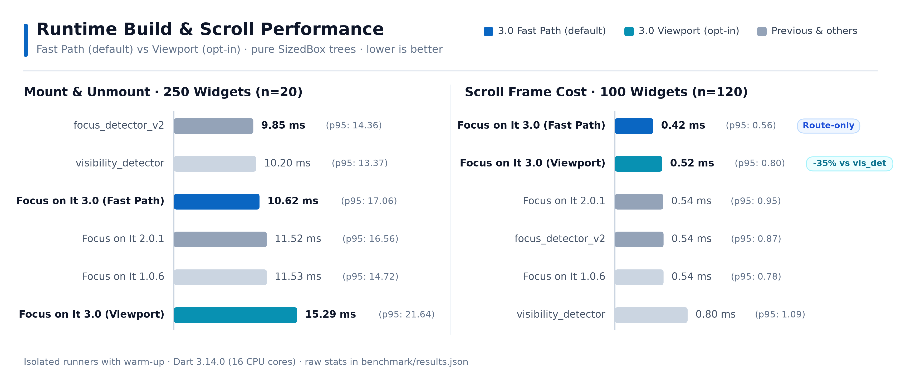

<p align="center">
  <picture>
    <source media="(prefers-color-scheme: dark)" srcset="https://raw.githubusercontent.com/luanemanuel/focus_on_it/3.0.0-dev/assets/focus_on_it_dark.png">
    <source media="(prefers-color-scheme: light)" srcset="https://raw.githubusercontent.com/luanemanuel/focus_on_it/3.0.0-dev/assets/focus_on_it_light.png">
    
  </picture>
</p>

<p align="center">
  <a href="https://pub.dev/packages/focus_on_it"></a>
  <a href="https://github.com/luanemanuel/focus_on_it/actions"></a>
  <a href="https://pub.dev/packages/very_good_analysis"></a>
  <a href="https://opensource.org/licenses/MIT"></a>
  <a href="https://flutter.dev"></a>
</p>

Focus on It tells you when a Flutter widget actually has the user's attention.

Wrap a screen, tab, or feed item to pause video, mute audio, stop camera previews, or sync state the moment someone pushes a route, opens a dialog, switches tabs, scrolls an item offscreen, or backgrounds the app. Zero external dependencies.

## Install

```sh
flutter pub add focus_on_it:^3.0.0-dev.2
```

Or add it to your `pubspec.yaml`:

```yaml
dependencies:
  focus_on_it: ^3.0.0-dev.2
```

```dart
import 'package:focus_on_it/focus_on_it.dart';
```

## Usage

```dart
@override
Widget build(BuildContext context) {
  return FocusOnIt(
    onFocus: () => videoController.play(),
    onUnfocus: () => videoController.pause(),
    onVisibilityGained: () => ticker.start(),
    onVisibilityLost: () => ticker.stop(),
    onForegroundGained: () => socket.reconnect(),
    onForegroundLost: () => analytics.flush(),
    child: const VideoPlayerView(),
  );
}
```

Dialogs and bottom sheets unfocus the route underneath and restore focus when closed; pass `includeDialogs: false` if only opaque routes should unfocus. Tab containers such as `IndexedStack` (including `GoRouter`'s `StatefulShellRoute.indexedStack`), `Offstage`, and `TickerMode` are tracked automatically.

## Scrollable feeds & viewports

If the widget lives inside a `ListView`, `PageView`, `CustomScrollView`, or `NestedScrollView` and should react as it scrolls into and out of view, pass `viewport`:

```dart
FocusOnIt(
  onFocus: () => playPreview(),
  onUnfocus: () => pausePreview(),
  viewport: FocusViewportConfig(
    threshold: 0.6,
    minFocusDuration: const Duration(milliseconds: 250),
    onVisibilityChanged: (info) {
      debugPrint('visible=${info.visibleFraction}');
    },
  ),
  child: const FeedVideoCard(),
)
```

`threshold` sets how much of the widget must be visible in `(0.0, 1.0]` before it counts as visible (defaults to `0.5`, and still works for widgets taller than the viewport). `minFocusDuration` skips quick flings by requiring visibility to hold before firing `onFocus`. By default `applyDwellOnResume` is `false` so visible items resume immediately after returning from the background; set it to `true` if `minFocusDuration` should also apply on app resume.

## Reading focus state

Attach a `FocusOnItController`, or read the state directly from descendant widgets:

```dart
final controller = FocusOnItController();

FocusOnIt(
  controller: controller,
  child: Builder(
    builder: (context) {
      final isFocused = FocusOnIt.isFocusedOf(context);
      return StatusIndicator(active: isFocused);
    },
  ),
);
```

- `FocusOnIt.isFocusedOf(context)` rebuilds that child only when focus changes.
- `FocusOnIt.of(context)` gives you the full `FocusState` (`isFocused`, `isVisible`, `isInForeground`, `visibleFraction`).
- `FocusOnItController` extends `ValueNotifier<FocusState>`, so it plugs into listeners and `ValueListenableBuilder`.

## App lifecycle

If you need window or exit hooks from `AppLifecycleListener`, pass `appLifecycle`:

```dart
FocusOnIt(
  onFocus: () {},
  onUnfocus: () {},
  appLifecycle: FocusAppLifecycleCallbacks(
    onHide: () => saveDraft(),
    onInactive: () => muteAudio(),
    onRestart: () => refreshSession(),
    onExitRequested: () async => AppExitResponse.exit,
    onStateChange: (oldState, newState) {
      debugPrint('$oldState -> $newState');
    },
  ),
  child: const EditorScreen(),
)
```

Across mobile, web, and desktop, `paused` and `hidden` (backgrounded apps, hidden browser tabs, minimized desktop windows) clear focus and restore it on `resumed`. On desktop, losing OS window focus fires `appLifecycle.onInactive` while keeping route focus active so side-by-side windows aren't disrupted until hidden. All `FocusOnIt` widgets share a single `AppLifecycleListener`, creating an extra one only when `onExitRequested` is set.

## Benchmarks

Each package runs in its own isolated test project with warm-up rounds and plain `SizedBox` trees so layout cost doesn't skew the numbers.

<p align="center">
  
</p>

<p align="center">
  
</p>

By default, Focus on It skips viewport math completely (`Fast Path`) and reacts on the next frame after route or dialog transitions. Enabling `viewport` runs batched scroll intersection checks only for the widgets that opt in. Raw stats and runner setup live in [benchmark/README.md](https://github.com/luanemanuel/focus_on_it/blob/3.0.0-dev/benchmark/README.md).

## Trade-offs

Focus on It avoids polling timers and full render-layer traversals to keep normal screens and feeds fast. Because of that:

- Paint-only animations (`SlideTransition`, `Transform.translate`) don't re-measure `viewport` bounds until the next layout or scroll tick.
- Non-scrollable clips (`ClipRect`, `ClipRRect`, `OverflowBox`) and sibling overlays inside a `Stack` (outside `Navigator` routes/dialogs) don't count toward visibility fractions.
- Rotated widgets (`Transform.rotate`) use an axis-aligned bounding box, which overestimates the visible area at angled rotations.
- Widgets inside `IndexedStack` or `Offstage` run a small cached ancestor check per frame to catch non-rebuilding switches such as `const` tab lists, whereas regular routes stay purely event-driven.

## Example

The [example](example/) app covers route and dialog focus, scrollable viewports, and `IndexedStack` tabs with `FocusOnIt.isFocusedOf(context)`.

## Upgrading from 2.x

Run `dart fix --apply` to drop removed parameters automatically, and see [MIGRATION.md](MIGRATION.md) for the short list of API updates.

## Contributing

Issues and pull requests are welcome on [GitHub](https://github.com/luanemanuel/focus_on_it/issues). Keep code formatted (`dart format`), clean under `flutter analyze --fatal-infos`, and covered by tests.

## License

MIT — see [LICENSE](LICENSE).
