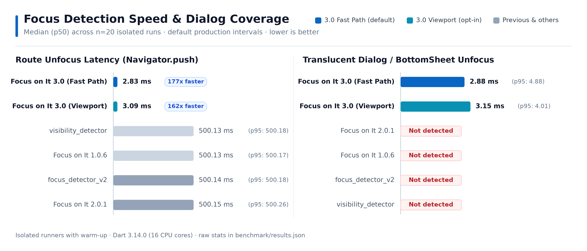

<p align="center">
  <picture>
    <source media="(prefers-color-scheme: dark)" srcset="https://raw.githubusercontent.com/luanemanuel/focus_on_it/3.0.0-dev/assets/focus_on_it_dark.png">
    <source media="(prefers-color-scheme: light)" srcset="https://raw.githubusercontent.com/luanemanuel/focus_on_it/3.0.0-dev/assets/focus_on_it_light.png">
    
  </picture>
</p>

<p align="center">
  <a href="https://pub.dev/packages/focus_on_it"></a>
  <a href="https://github.com/luanemanuel/focus_on_it/actions"></a>
  <a href="https://pub.dev/packages/very_good_analysis"></a>
  <a href="https://opensource.org/licenses/MIT"></a>
  <a href="https://flutter.dev"></a>
</p>

Focus on It lets you know when a Flutter widget actually has the user's attention.

Wrap any screen or widget to pause videos, mute audio, stop camera previews, or sync state the moment someone switches routes, opens a dialog, changes tabs, scrolls past an item, or sends the app to the background. It has zero external dependencies and runs straight on Flutter.

## Install

Add it with Flutter:

```sh
flutter pub add focus_on_it:^3.0.0-dev.1
```

Or add it to your `pubspec.yaml`:

```yaml
dependencies:
  focus_on_it: ^3.0.0-dev.1
```

Then import it:

```dart
import 'package:focus_on_it/focus_on_it.dart';
```

## Basic usage

Wrap the widget you want to watch with `FocusOnIt`:

```dart
@override
Widget build(BuildContext context) {
  return FocusOnIt(
    onFocus: () => videoController.play(),
    onUnfocus: () => videoController.pause(),
    onVisibilityGained: () => ticker.start(),
    onVisibilityLost: () => ticker.stop(),
    onForegroundGained: () => socket.reconnect(),
    onForegroundLost: () => analytics.flush(),
    child: const VideoPlayerView(),
  );
}
```

Opening a dialog or bottom sheet unfocuses the screen behind it and focuses it again when dismissed. If you only want full opaque route changes to unfocus, pass `includeDialogs: false`. `IndexedStack`, `Offstage`, and `TickerMode` transitions are handled automatically too.

## Scrollable feeds & viewports

If your widget sits inside a `ListView`, `PageView`, or `CustomScrollView` and should react as it scrolls in and out of view, pass `viewport`:

```dart
FocusOnIt(
  onFocus: () => playPreview(),
  onUnfocus: () => pausePreview(),
  viewport: FocusViewportConfig(
    threshold: 0.6,
    minFocusDuration: const Duration(milliseconds: 250),
    onVisibilityChanged: (info) {
      debugPrint('visible=${info.visibleFraction}');
    },
  ),
  child: const FeedVideoCard(),
)
```

`threshold` sets the minimum visible fraction in `[0.0, 1.0]` before the widget counts as visible (defaults to `0.5`, and still triggers even when a widget is taller than the screen). `minFocusDuration` waits for the widget to stay above `threshold` for that long before firing `onFocus`, which helps ignore quick flings.

## Reading focus state

Need the focus state outside a callback? Attach a `FocusOnItController`, or read it directly inside child widgets:

```dart
final controller = FocusOnItController();

FocusOnIt(
  controller: controller,
  child: Builder(
    builder: (context) {
      final isFocused = FocusOnIt.isFocusedOf(context);
      return StatusIndicator(active: isFocused);
    },
  ),
);
```

- `FocusOnIt.isFocusedOf(context)` only rebuilds that child when focus actually flips.
- `FocusOnIt.of(context)` gives you the full `FocusState` (`isFocused`, `isVisible`, `isInForeground`, `visibleFraction`).
- `FocusOnItController` extends `ValueNotifier<FocusState>`, so you can listen to it or bind it to `ValueListenableBuilder`.

## App lifecycle hooks

If you also want window or exit hooks from `AppLifecycleListener`, pass `appLifecycle`:

```dart
FocusOnIt(
  onFocus: () {},
  onUnfocus: () {},
  appLifecycle: FocusAppLifecycleCallbacks(
    onHide: () => saveDraft(),
    onInactive: () => muteAudio(),
    onRestart: () => refreshSession(),
    onExitRequested: () async => AppExitResponse.exit,
    onStateChange: (oldState, newState) {
      debugPrint('$oldState -> $newState');
    },
  ),
  child: const EditorScreen(),
)
```

All `FocusOnIt` widgets in the same app share a single `AppLifecycleListener` underneath, only creating a separate one if a widget sets `onExitRequested`.

## Benchmarks

Each package runs in its own isolated test project with warm-up rounds and plain `SizedBox` trees so layout noise doesn't get in the way.

<p align="center">
  
</p>

<p align="center">
  
</p>

By default, Focus on It skips viewport math completely (`Fast Path`) and triggers on the next frame after a route or dialog transition, keeping scroll frames light. Turning on `viewport` enables per-frame scroll intersection checks only for the widgets that ask for it.

Full runner setup and raw numbers live in [benchmark/README.md](benchmark/README.md).

## Upgrading from 2.x

Run `dart fix --apply` to clean up removed parameters automatically, and check [MIGRATION.md](MIGRATION.md) for the short list of API updates.

## Example

The [example](example/) app includes three small demos covering route and dialog focus, scrollable viewports, and `IndexedStack` tabs with `FocusOnIt.isFocusedOf(context)`.

## Contributing & issues

Found a bug or want to pitch an improvement? Open an issue or pull request on [GitHub](https://github.com/luanemanuel/focus_on_it/issues). Keep code formatted (`dart format`), clean under `flutter analyze --fatal-infos`, and covered by tests.

## License

MIT — see [LICENSE](LICENSE).
